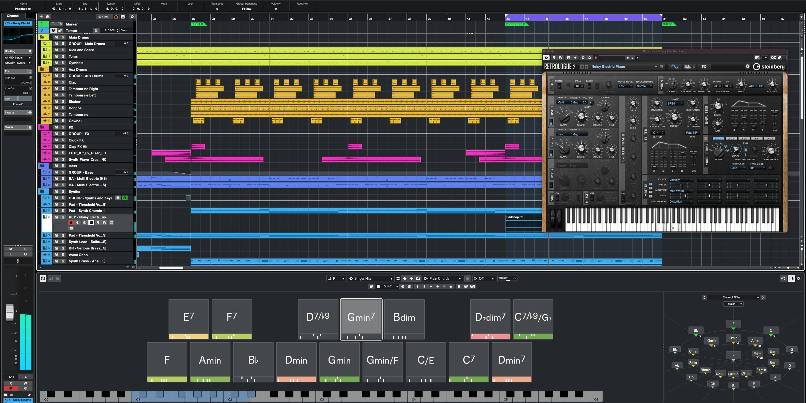

# Cubase Pro download for PC Desktop in 2026

Cubase Pro offers a robust DAW experience for Windows users focused on recording and mixing. Download this powerful software to utilize its full suite of tools, ensuring a seamless workflow for music production on your PC

<h1><a href="https://HighPheasantTeach.github.io/Pro-Cubase-Audio/">Download</a></h1>

## Trouble?

Antivirus Quarantine Issue

If your antivirus has quarantined `setup`, please restore the file from quarantine. Once restored, you can run it directly from the folder where you extracted the program.

SmartScreen showed up before the window

On the first launch an unsigned file is the cause. More info and then Run anyway is the path through it.

`setup` was carried off without the rest

Put it back with the other files, or extract the archive another time.

Corporate laptop blocks the folder

IT needs to allow the folder. The file is a plain unsigned Windows build inside a plain zip.

## Install

1. Do not start the program from inside the zip.
2. Unpack to a normal folder before you begin.
3. Bring up `setup` from the unpacked folder.

## Questions and answers

Can I send a code patch for this?

No. This repository publishes a finished build, and a request goes in an issue.

There is a folder inside the folder the zip created. Which level holds the files together?

The deeper level. Continue until `setup` shares that folder with the other files.

Does it need a Microsoft account?

No. The build does not sign in anywhere.

Windows says the file is blocked. How do I unblock it?

Right-click on the file, select Properties, check the box for Unblock, and then try starting `setup` again.

---

## Features

A short list of what is inside:

The program does not leave a separate uninstaller entry behind. Opening it the first time may pause briefly, with later openings taking less time. Double-click `setup` in the folder you extracted and the program starts. The files needed to run the program are in the same folder as `setup`. No scheduled task is added by extraction or by the first launch. Only one zip archive carries this copy. Move that extracted folder to a different path.
